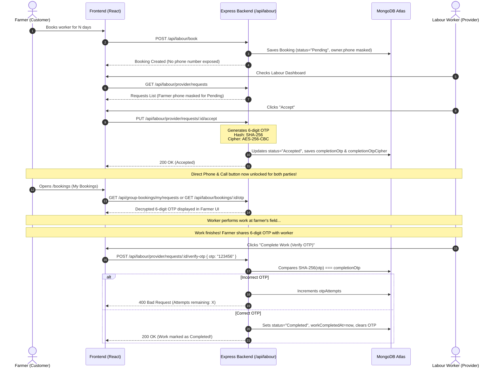

# Labour Booking Call Access & Secure OTP Work Completion System

## 1. Overview & Objective

To ensure safety, prevent off-platform disintermediation, and protect customer privacy, WorkShetu enforces:
1. **Call & Phone Access Control**: Customers cannot view worker phone numbers or call buttons until the worker has reviewed and `Accepted` the booking. Direct backend APIs strictly mask contact numbers for `Pending`, `Rejected`, and `Cancelled` states.
2. **Secure OTP Work Completion System**: Work is verified and completed via a cryptographically secure 6-digit OTP generated upon booking acceptance. The customer provides this OTP only after physical work completion, and the worker enters the code in their dashboard to finalize wages.

---

## 2. End-to-End Sequence Diagram



---

## 3. Database Model Specification (`BookingMachine.js`)

The `Booking` schema is extended with the following security fields:

```javascript
// Work Completion & Security Fields
completionOtp: {
    type: String,
    select: false // Stores SHA-256 hash of the 6-digit OTP
},
completionOtpCipher: {
    type: String,
    select: false // AES-256-CBC encrypted token for customer retrieval
},
completionOtpExpiresAt: {
    type: Date,
    select: false // Timestamp when the OTP expires (default 10 minutes)
},
otpAttempts: {
    type: Number,
    default: 0,
    select: false // Counter tracking failed verification attempts
},
otpCooldownUntil: {
    type: Date,
    default: null,
    select: false // Rate limiting cooldown (60 seconds)
},
otpVerified: {
    type: Boolean,
    default: false
},
otpVerifiedAt: {
    type: Date,
    default: null
},
workCompletedAt: {
    type: Date,
    default: null
}
```

---

## 4. API Endpoint Specifications

### 4.1 `POST /api/labour/book`
- **Role**: Authenticated Customer (Farmer)
- **Privacy Rule**: Before acceptance, `owner.phone` is stripped before returning the JSON response.
- **Response**: Status 201 Created with sanitized booking object.

### 4.2 `PUT /api/labour/provider/requests/:id/accept`
- **Role**: Authenticated Labour Worker
- **Action**: Transitions booking from `Pending` to `Accepted`.
- **Security Logic**:
  1. Generates 6-digit OTP via `crypto.randomInt(100000, 1000000)`.
  2. Hashes OTP with SHA-256: `booking.completionOtp = hashOtp(plainOtp)`.
  3. Encrypts plaintext OTP with AES-256-CBC: `booking.completionOtpCipher = encryptOtp(plainOtp)`.
  4. Sets `otpAttempts = 0` and `otpCooldownUntil = Date.now() + 60000`.
  5. Unlocks customer phone for worker and worker phone for customer.

### 4.3 `POST /api/labour/provider/requests/:id/request-otp`
- **Role**: Authenticated Labour Worker
- **Purpose**: Generates a new OTP or refreshes an expired one.
- **Constraints**:
  - Requires status to be `Accepted`.
  - Enforces 60-second cooldown (`otpCooldownUntil`). If invoked within cooldown, returns HTTP 429 with remaining seconds.
  - Sets 10-minute expiry (`completionOtpExpiresAt = Date.now() + 10 * 60 * 1000`).
  - Does NOT return the plaintext OTP in the provider response.

### 4.4 `GET /api/labour/bookings/:id/otp`
- **Role**: Authenticated Customer (`customer._id === req.user._id`)
- **Purpose**: Displays the plain 6-digit OTP on the customer's device.
- **Security Validation**:
  - Returns 403 Forbidden if called by the worker or any third party.
  - Returns 400 Bad Request if booking is not `Accepted`.
  - Returns 410 Gone if OTP is expired.
  - Decrypts `completionOtpCipher` and returns `{ success: true, otp: "...", expiresAt }`.

### 4.5 `POST /api/labour/provider/requests/:id/verify-otp`
- **Role**: Authenticated Labour Worker (`owner._id === req.user._id`)
- **Input**: `{ otp: "123456" }`
- **Security Validation**:
  - Max Attempts Check: If `otpAttempts >= 5`, returns HTTP 429 lockout.
  - Expiry Check: If `completionOtpExpiresAt < now`, returns HTTP 410.
  - Hash Comparison: Computes `sha256(inputOtp)` and checks against `booking.completionOtp`.
  - On Mismatch: Increments `otpAttempts` by 1 and returns remaining attempts.
  - On Success:
    - Sets `status = "Completed"`.
    - Sets `workCompletedAt = new Date()`.
    - Sets `otpVerified = true`.
    - Finalizes wages in `earning`.
    - Clears sensitive fields: `completionOtp = null`, `completionOtpCipher = null`.

---

## 5. Frontend User Experience

### 5.1 Customer UI (`MyBooking.jsx`)
- For `Accepted` Labour bookings:
  - Displays the 6-digit OTP inside a prominent card with a one-click **Copy OTP** button.
  - Shows localized warning: `⚠️ काम पूरा होने के बाद ही यह OTP लेबर / वर्कर को बताएं।`
  - Unlocks worker contact card and **Call Worker** button.
- For `Pending`, `Rejected`, or `Cancelled` bookings:
  - Call button and worker phone are completely hidden.

### 5.2 Labour Worker UI (`LabourDashboard.jsx`)
- For `Accepted` requests:
  - Displays a **Complete Work (Verify OTP)** button.
  - Clicking opens the OTP Verification modal with client name and total wage summary.
  - Includes a 6-digit formatted numeric input field.
  - Features a **Request New OTP** button with an automatic 60-second cooldown countdown timer.
  - Once verified, the modal displays success feedback, closes automatically, and updates dashboard metrics and total earnings.
