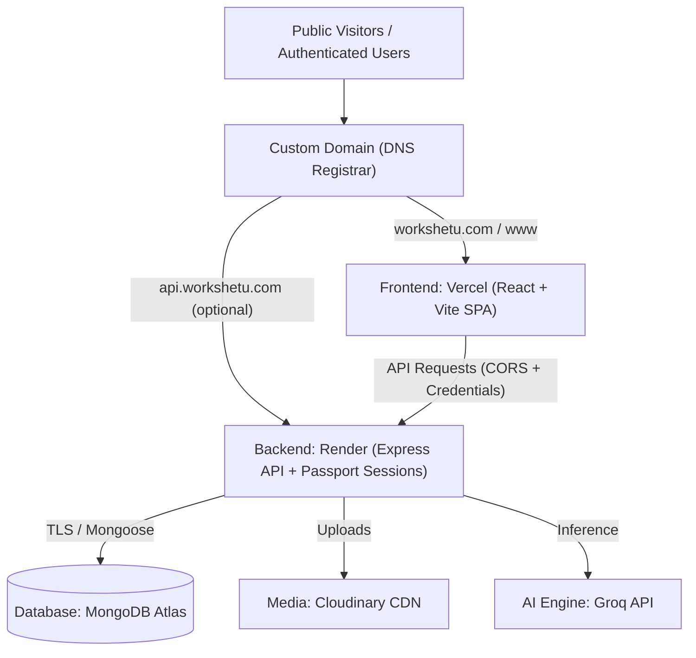

# WorkShetu Production Deployment Guide
**Architecture**: Frontend on Vercel | Backend on Render | Database on MongoDB Atlas | Custom Domain & SSL

---

## 1. Architecture Overview



---

## 2. Step 1: Backend Deployment on Render

1. Log in to [dashboard.render.com](https://dashboard.render.com).
2. Click **New +** → **Web Service**.
3. Connect your GitHub repository (`Project-WorkShetu`).
4. Configure the Web Service settings:
   - **Name**: `workshetu-api`
   - **Region**: Oregon (US West) or Singapore / Frankfurt (choose closest to your users)
   - **Branch**: `main`
   - **Root Directory**: `Backend`
   - **Runtime**: `Node`
   - **Build Command**: `npm install`
   - **Start Command**: `node App.js` (or `npm start`)
   - **Health Check Path**: `/health`
5. Click **Advanced** → Add Environment Variables:
   - `NODE_ENV`: `production`
   - `PORT`: `10000`
   - `MONGO_URL`: `mongodb+srv://<username>:<password>@cluster0.xxxxx.mongodb.net/workshetu?retryWrites=true&w=majority`
   - `SESSION_SECRET`: *(Generate a secure random string of 32+ characters)*
   - `CLIENT_URL`: `https://your-custom-domain.com` *(or your Vercel URL)*
   - `FRONTEND_URL`: `https://your-custom-domain.com`
   - `CUSTOM_DOMAIN`: `your-custom-domain.com`
   - `CLOUD_NAME`: *(Your Cloudinary cloud name)*
   - `API_KEY`: *(Your Cloudinary API key)*
   - `API_SECRET`: *(Your Cloudinary API secret)*
   - `GROQ_API_KEY`: *(Your Groq API key)*
   - `GROQ_MODEL`: `openai/gpt-oss-120b`
6. Click **Create Web Service**.
7. Wait for deployment to finish. Once live, test the health check in your browser:
   `https://workshetu-api.onrender.com/health`
   Expected response:
   ```json
   {
     "status": "ok",
     "service": "workshetu-api",
     "database": "connected",
     "timestamp": "2026-11-24T...",
     "uptime": 12
   }
   ```

---

## 3. Step 2: Frontend Deployment on Vercel

1. Log in to [vercel.com](https://vercel.com).
2. Click **Add New...** → **Project**.
3. Select the `Project-WorkShetu` repository.
4. Configure Project settings:
   - **Framework Preset**: `Vite`
   - **Root Directory**: Click *Edit* and select `Frontend`
   - **Build Command**: `npm run build`
   - **Output Directory**: `dist`
   - **Install Command**: `npm install`
5. Expand **Environment Variables**:
   - `VITE_API_URL`: Set to your Render backend URL (e.g. `https://workshetu-api.onrender.com` or `https://api.yourdomain.com`).
     *(Note: Do NOT include trailing slash)*
6. Click **Deploy**.
7. Once deployment completes, Vercel will provide an initial URL (e.g. `https://project-workshetu.vercel.app`).
8. The included `vercel.json` automatically manages single-page application (SPA) routing, ensuring direct links (such as `/bookings?type=labour` or `/Labour/dashboard`) do not 404 on page refresh.

---

## 4. Step 3: Custom Domain Configuration

### A. Point Custom Domain to Vercel (Frontend)
1. In your **Vercel Project Dashboard**, navigate to **Settings** → **Domains**.
2. Enter your custom domain (e.g., `workshetu.com`).
3. Vercel will display the required DNS records for your registrar (GoDaddy, Namecheap, Cloudflare, Hostinger, etc.):
   - **Apex domain (`@` or `workshetu.com`)**:
     - **Type**: `A`
     - **Name**: `@`
     - **Value**: `76.76.21.21`
   - **Subdomain (`www`)**:
     - **Type**: `CNAME`
     - **Name**: `www`
     - **Value**: `cname.vercel-dns.com`
4. In your DNS provider's control panel, add these records. Vercel will automatically provision a free Let's Encrypt SSL/TLS certificate.

### B. (Optional) Custom API Subdomain on Render (Backend)
If you wish to serve the backend from `api.workshetu.com`:
1. In your **Render Dashboard** → `workshetu-api` → **Settings** → **Custom Domains**.
2. Click **Add Custom Domain** and enter `api.workshetu.com`.
3. In your DNS registrar, add the CNAME record provided by Render:
   - **Type**: `CNAME`
   - **Name**: `api`
   - **Value**: `workshetu-api.onrender.com`
4. Update `CLIENT_URL` on Render to `https://workshetu.com`, and `VITE_API_URL` on Vercel to `https://api.workshetu.com`.

---

## 5. Step 4: MongoDB Atlas Production Security

1. In MongoDB Atlas, go to **Network Access**.
2. Add an IP Access rule:
   - **IP Address**: `0.0.0.0/0` (Required for dynamic egress from Render cloud instances).
3. In **Database Access**:
   - Create a dedicated user with `readWrite` access to the `workshetu` database.
   - Use a strong, URL-encoded password without special characters that break URI strings (`@`, `:`, `/`, `?`).

---

## 6. Production Verification & Smoke Test Checklist

Once both services are deployed and DNS has propagated:

- [ ] **Public Browsing**: Homepage opens without any login prompt; machines and labour listings load correctly.
- [ ] **Near Me GPS**: Browser prompts for location; nearby machines and workers display accurately without infinite reload loops.
- [ ] **Authentication**: User registration, login, logout, and persistent session after page refresh.
- [ ] **Cross-Role Booking**: Driver can book another driver's machine or a labour worker; labour worker can book a machine.
- [ ] **Self-Booking Prevention**: Attempting to book one's own listing returns `"You cannot book your own listing."`.
- [ ] **Post-Booking Redirection**: Machine booking opens `/bookings?type=machine`; Labour booking opens `/bookings?type=labour` with smooth card highlight.
- [ ] **Contact Privacy**: Worker phone numbers remain masked on `Pending` bookings and reveal only on `Accepted`/`Completed` bookings.
- [ ] **OTP Work Completion**: Customer sees 6-digit OTP; worker enters it to complete booking; OTP cleared upon verification.
- [ ] **AI Assistant**: Farmer, Driver, and Labour assistant tabs provide intelligent, localized responses using real database queries.

---

## 7. Rollback Procedure

If any issue arises in production:
1. **Frontend Rollback (Instant)**:
   - In Vercel Dashboard → **Deployments**.
   - Locate the previous successful deployment.
   - Click the three dots (`...`) → **Promote to Production**. Vercel rolls back instantly with zero downtime.
2. **Backend Rollback (Instant)**:
   - In Render Dashboard → `workshetu-api` → **Events / Deploys**.
   - Select the last stable build and click **Rollback**.
